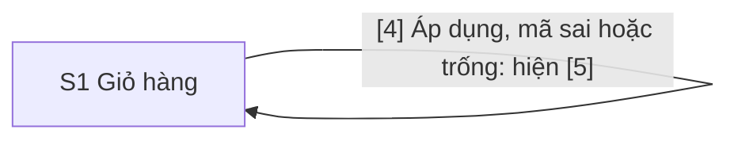

# Design: Mã giảm giá cho giỏ hàng

> **Epic:** DEMO-11 · **Jira:** https://phunghuutung12b4.atlassian.net/browse/DEMO-11 · **Spec:** docs/specs/DEMO-11/spec.md · **Status:** Draft
>
> **Figma version:** none

## Screens

| Code | Name | Route | User story | Kind |
|---|---|---|---|---|
| S1 | Giỏ hàng | / (GET, POST) | Là người mua, tôi muốn nhập mã giảm giá trên trang giỏ hàng để thấy ngay số tiền được giảm và tổng cộng mới (user story 1), và được báo rõ khi mã không dùng được (user story 2) | ASCII |

User story 3 (AC9–AC11) không có màn hình. Các câu 400, 403 và 413 là `text/plain`, như 404 và 405 hiện có (body "Not found" và "Method not allowed" trong `src/server.ts`), không thuộc S1. Body của ba câu mới là "Bad request" (400), "Forbidden" (403) và "Payload too large" (413); `sa` ghi vào plan.

## Flow



## Screen Details

### S1 · Giỏ hàng

Bản vẽ vẽ trạng thái của AC7: đã áp `GIAM10`, rồi nhập `SAIMA`. Trạng thái này có đủ các khối; [5] và [7] chỉ hiện khi cần.

```text
S1 · Giỏ hàng · desktop
+--------------------------------------------------------------+
| [1] Giỏ hàng                                                 |
|                                                              |
| [2] Sản phẩm   Đơn giá    Số lượng   Thành tiền              |
|     Bút bi     5.000 ₫    3          15.000 ₫                |
|     Sổ tay     12.000 ₫   2          24.000 ₫                |
|                                                              |
| [3] Mã giảm giá                                              |
|     [______________________________]  [4] (Áp dụng)          |
| [5] Mã giảm giá không hợp lệ.                                |
|                                                              |
| [6] Tạm tính            39.000 ₫                             |
| [7] Giảm giá (GIAM10)   -3.900 ₫                             |
| [8] Phí vận chuyển      3.000 ₫                              |
| [9] Tổng cộng           38.100 ₫                             |
+--------------------------------------------------------------+
```

```text
S1 · Giỏ hàng · mobile
+------------------------------------+
| [1] Giỏ hàng                       |
|                                    |
| [2] Bảng sản phẩm, như desktop     |
|                                    |
| [3] Mã giảm giá                    |
|     [__________________________]   |
|     [4] (Áp dụng)                  |
| [5] Mã giảm giá không hợp lệ.      |
|                                    |
| [6] Tạm tính            39.000 ₫   |
| [7] Giảm giá (GIAM10)   -3.900 ₫   |
| [8] Phí vận chuyển      3.000 ₫    |
| [9] Tổng cộng           38.100 ₫   |
+------------------------------------+
```

```yaml
screen: S1
route: /
blocks:
  1:
    name: Tiêu đề trang
    type: heading
    content: '"Giỏ hàng", thẻ h1 duy nhất của trang, không đổi so với DEMO-10'
  2:
    name: Bảng sản phẩm
    type: table
    content: Tên, đơn giá, số lượng và thành tiền của từng dòng, không đổi so với DEMO-10
    behavior: Epic không đổi bảng này. Nếu bảng tràn ngang ở một trong bốn cỡ kiểm (mục Bố cục), tách một Task riêng, không sửa trong Epic này.
    states:
      empty: 'Giỏ trống: trang hiện "Giỏ hàng trống." và không có [3] đến [9], kể cả ô nhập mã'
  3:
    name: Ô nhập mã giảm giá
    type: input
    content: 'Nhãn hiện "Mã giảm giá", nằm trên ô. Ô là một dòng chữ (type text) với maxlength="64"; sa chốt tên trường. Tìm bằng nhãn "Mã giảm giá"'
    behavior: >-
      Nhấn Enter trong ô gửi form như bấm [4]. Mã được bỏ khoảng trắng hai đầu và đổi sang chữ hoa trước khi so với
      danh sách.
    validation: >-
      Không dùng thuộc tính required, để server kiểm và mọi trình duyệt hiện cùng một thông báo. Trống sau khi bỏ
      khoảng trắng thì hiện [5] "Vui lòng nhập mã giảm giá."; không có trong danh sách thì hiện [5] "Mã giảm giá không
      hợp lệ." maxlength="64" chỉ để người mua bình thường không chạm giới hạn body 1.024 byte; server vẫn tự kiểm,
      và mã dài hơn chỉ là mã không hợp lệ.
    states:
      default: Trống
      applied: Trống sau khi áp mã đúng; mã đang áp hiện ở [7]
      error: >-
        Giữ đúng chuỗi người dùng đã gõ, không chuẩn hóa, và qua escapeHtml trong value="…" có dấu nháy (AC5, AC8).
        Có autofocus, aria-invalid="true" và aria-describedby trỏ tới [5]. Không có lỗi thì không có cả ba thuộc tính.
    a11y: >-
      Nhãn gắn với ô bằng for và id. Thứ tự Tab: [3] rồi [4]. Viền ô dày hơn khi có lỗi, để lỗi không chỉ dựa vào màu.
      autofocus chỉ có khi [5] hiện. [Unverified] Chưa kiểm autofocus trên Chrome với CSP của trang; fe-dev kiểm, và
      nếu autofocus không chạy thì bỏ nó, giữ aria-invalid và aria-describedby.
    ac: [AC3, AC5, AC6, AC8]
  4:
    name: Nút Áp dụng
    type: button
    content: Nhãn "Áp dụng". Tìm bằng role button với tên "Áp dụng"
    behavior: >-
      Gửi form POST / dạng application/x-www-form-urlencoded, gồm ô [3] và mã đang áp (ví dụ trong một trường ẩn;
      sa chốt tên trường trong plan). Server kiểm lại cả hai mã, không nhận số tiền từ form. Mã mới đúng thì thay mã cũ
      và [7] đổi theo. Mã mới sai hoặc trống thì hiện [5] và giữ mã đang áp. Server trả thẳng trang 200 cho POST /,
      không chuyển hướng, vì không lưu trạng thái; giữ mã đã áp khi tải lại trang nằm ngoài phạm vi của SPEC. Trang
      không đặt Referrer-Policy: no-referrer, bằng header hay thẻ meta.
    states:
      focus: Giữ viền focus của trình duyệt, không tắt outline
    a11y: Là button type submit với nhãn chữ hiển thị. Trang không có script, nên không có trạng thái đang gửi.
    ac: [AC1, AC2, AC4, AC7]
  5:
    name: Thông báo lỗi của mã
    type: text
    content: '"Mã giảm giá không hợp lệ." hoặc "Vui lòng nhập mã giảm giá.", một câu một lần, nằm dưới hàng [3] [4]. data-testid: coupon-error'
    behavior: Chỉ hiện khi POST bị từ chối vì mã. Câu không chứa mã người dùng gõ. Khi [5] hiện, [6] đến [9] vẫn tính theo mã đang áp, nếu có (AC5, AC7).
    a11y: Có id để [3] trỏ tới bằng aria-describedby. Chữ màu lỗi, nhưng câu chữ tự nói đây là lỗi.
    ac: [AC5, AC6, AC7, AC8]
  6:
    name: Dòng Tạm tính
    type: text
    content: 'Tạm tính của giỏ, trước giảm. data-testid hiện có: subtotal'
    ac: [AC1]
  7:
    name: Dòng Giảm giá
    type: text
    content: >-
      Nhãn "Giảm giá (<mã>)", với mã ở dạng chữ hoa; giá trị là số tiền giảm kèm dấu trừ, như "-3.900 ₫" (dấu gạch
      nối ASCII và no-break space trước ₫, đúng kết quả formatMoney(-3900)). Nằm giữa [6] và [8]. data-testid của
      giá trị: discount
    behavior: >-
      Chỉ hiện khi có mã đang áp, và chỉ một dòng: áp mã mới thì thay dòng cũ (AC4). Mã trong nhãn lấy từ danh sách mã
      và vẫn qua escapeHtml. Trang không có thông báo thành công: dòng này là dấu hiệu duy nhất cho thấy mã đã áp.
    states:
      none: Không có dòng này khi chưa áp mã
      applied: GIAM10 trên tạm tính 39.000 ₫ hiện "-3.900 ₫"; GIAM20K hiện "-20.000 ₫", và không vượt tạm tính
    a11y: Là cặp dt và dd như [6], [8], [9], nên trình đọc màn hình đọc nhãn rồi giá trị.
    ac: [AC1, AC2, AC3, AC4, AC7]
  8:
    name: Dòng Phí vận chuyển
    type: text
    content: 'Phí vận chuyển tính trên tạm tính trước giảm, nên không đổi sau khi áp mã. "Miễn phí" khi tạm tính từ 50.000 ₫. data-testid hiện có: shipping'
    ac: [AC1]
  9:
    name: Dòng Tổng cộng
    type: text
    content: 'Tạm tính trừ số tiền giảm, cộng phí vận chuyển; không bao giờ âm. data-testid hiện có: total'
    ac: [AC1, AC2, AC3, AC4, AC5, AC6, AC7]
```

Bố cục theo cỡ màn hình:

- Giữ cách dựng hiện có: một cột, font hệ thống, khoảng cách theo bậc 0,25 rem như `STYLE` của `src/page.ts`, không đổ bóng, không gradient, không thêm màu ngoài màu chữ lỗi của [5].
- Hàng [3] và [4] dùng flex-wrap, không media query: ô và nút nằm một hàng khi đủ chỗ; khi hàng không đủ chỗ (màn hình hẹp), nút xuống dòng dưới ô và ô co giãn tới hết dòng.
- Danh sách [6] đến [9] giữ lưới hai cột của `dl` hiện có. Dòng [7] chèn vào cùng lưới.
- Câu chữ "Mã giảm giá" (nhãn [3]) và "Giảm giá (<mã>)" (nhãn [7]) là câu chữ của design, đã được chốt cùng ba câu của SPEC.
- Bố cục thật chưa kiểm vì chưa có code. `fe-dev` và `qa` kiểm trang ở 320, 768, 1024 và 1440 px. [Unverified] Bảng [2] bốn cột ở 320 px chưa kiểm có tràn ngang không.
- Ngoài phạm vi, nên không có màn hình hay trạng thái: nút bỏ mã, hạn dùng, điều kiện đơn tối thiểu, số lượt dùng của mã.

## Open Questions

Không còn câu hỏi mở. Các câu Q1–Q10 của bản trước được trả lời ngày 2026-10-31, thay người duyệt. Các câu trả lời đã thành quyết định ở mục Screens (user story 3 và body của 400, 403, 413), trong YAML của các khối [2] đến [5] và [7], và trong mục Bố cục theo cỡ màn hình của S1.

- **Q1. User story 3 (AC9–AC11) không có màn hình.** Các câu 400, 403 và 413 là `text/plain`, như 404 và 405 hiện có, không thuộc S1. Body của 404 và 405 hiện là "Not found" và "Method not allowed" (đọc từ `src/server.ts`). Đề xuất: body 400, 403 và 413 cũng là tiếng Anh ngắn, như "Bad request", "Forbidden", "Payload too large"; `sa` chốt trong plan.
- **Q2. Sau khi áp mã đúng, ô [3] trống hay giữ mã?** Đề xuất: trống; mã đang áp hiện ở [7] và đi kèm form qua trường ẩn.
- **Q3. Có thông báo thành công không?** Đề xuất: không. SPEC chỉ chốt ba câu chữ và coi đổi câu chữ là "Ask first"; dòng [7] cho thấy mã đã áp. [Inference] Người dùng trình đọc màn hình chỉ biết mã đã áp khi đọc tới [7]; chưa kiểm với trình đọc màn hình.
- **Q4. Tiêu điểm khi có lỗi.** Đề xuất: thuộc tính `autofocus` trên [3], chỉ khi [5] hiện, cùng `aria-invalid` và `aria-describedby`. [Unverified] Tôi chưa kiểm `autofocus` với CSP của trang (`default-src 'none'`) trên Chrome, và chưa kiểm cách trình đọc màn hình đọc [5]. `fe-dev` kiểm; nếu `autofocus` không chạy thì bỏ nó và giữ phần ARIA.
- **Q5. Câu chữ ngoài ba câu SPEC đã chốt.** "Mã giảm giá" (nhãn [3]) và "Giảm giá (<mã>)" (nhãn [7]) là câu chữ của design, không phải của SPEC. Đề xuất: giữ; đổi câu chữ cần người duyệt.
- **Q6. `data-testid` mới.** Đề xuất `discount` (giá trị của [7]) và `coupon-error` ([5]); tìm ô [3] bằng nhãn và nút [4] bằng role button với tên "Áp dụng". `sa` chốt trong plan, cùng tên trường của form.
- **Q7. Giới hạn độ dài của ô [3].** Body của `POST /` quá 1.024 byte nhận 413 dạng chữ thô, không phải trang giỏ hàng. Đề xuất: thêm `maxlength="64"` vào [3] để người mua bình thường không chạm giới hạn đó. SPEC chưa nói tới `maxlength`; cần người duyệt đồng ý.
- **Q8. Câu trả lời của `POST /`.** Đề xuất: server trả thẳng trang 200, không chuyển hướng, vì server không lưu trạng thái. [Inference] Tải lại trình duyệt khi đó gửi lại form (trình duyệt có thể hỏi xác nhận). SPEC để "giữ mã đã áp khi tải lại trang" ngoài phạm vi.
- **Q9. Bố cục thật chưa kiểm.** Chưa có code, nên chưa kiểm ở 320, 768, 1024 và 1440 px. [Unverified] Bảng [2] bốn cột ở 320 px chưa kiểm có tràn ngang không; DEMO-10 làm bảng này và Epic không đổi nó. `fe-dev` và `qa` kiểm bốn cỡ; nếu bảng tràn, tách một Task riêng.
- **Q10. Không có màn hình hay trạng thái cho các trường hợp sau**, vì SPEC để ngoài phạm vi: nút bỏ mã, hạn dùng, điều kiện đơn tối thiểu, số lượt dùng.
