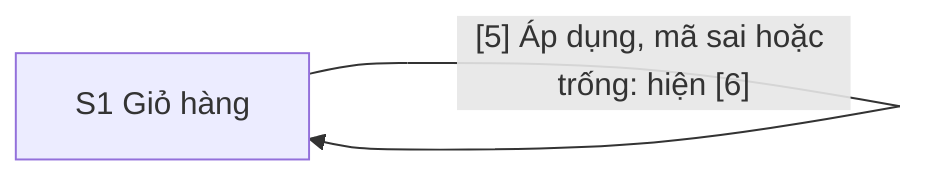

# Design: Xóa sản phẩm khỏi giỏ hàng

> **Epic:** DEMO-20 · **Jira:** https://phunghuutung12b4.atlassian.net/browse/DEMO-20 · **Spec:** docs/specs/DEMO-20/spec.md · **Status:** Draft
>
> **Figma version:** none

## Screens

| Code | Name | Route | User story | Kind |
|---|---|---|---|---|
| S1 | Giỏ hàng | / (GET, POST) | Là người mua, tôi muốn xóa một sản phẩm khỏi giỏ hàng để thấy ngay giỏ còn lại và số tiền mới (user story 1), và mã giảm giá đang áp được giữ, tính lại (user story 2) | ASCII |

Epic chỉ có một màn hình: S1 là trang giỏ hàng của DEMO-10 và DEMO-11, thêm nút "Xóa" vào mỗi dòng của bảng. Các trạng thái mới của S1 (một dòng đã xóa, giỏ trống) là trạng thái của các khối, không phải màn hình.

User story 3 (AC10, AC11) không có màn hình mới. Câu 403 của AC10 là `text/plain` với body "Forbidden", như hiện có trong `src/server.ts`, không thuộc S1. Trang của AC11 là S1 với giỏ mẫu đủ hai dòng.

Số khối của file này theo thứ tự đọc của S1 sau khi có nút "Xóa", nên từ khối 3 trở đi khác số khối trong design của DEMO-11: khối [3] là mới, và [3] đến [9] của DEMO-11 nay là [4] đến [10]. Chú thích `[5]`, `[7]` trong `src/page.ts` vẫn theo số của DEMO-11.

## Flow



Mọi mũi tên về chính S1: server không lưu trạng thái và trả thẳng trang 200 cho `POST /`, không chuyển hướng (SPEC, Technical requirements). Địa chỉ trang vẫn là `/`.

## Screen Details

### S1 · Giỏ hàng

Bản vẽ gộp mọi khối cho đủ: [6] và [8] chỉ hiện khi cần, và sau khi bấm "Xóa" thì [6] biến mất. Nút "Xóa" có ở mỗi dòng nhưng chỉ đánh số một lần, ở dòng đầu.

```text
S1 · Giỏ hàng · desktop
+--------------------------------------------------------------------+
| [1] Giỏ hàng                                                       |
|                                                                    |
| [2] Sản phẩm   Đơn giá    Số lượng   Thành tiền                    |
|     Bút bi     5.000 ₫    3          15.000 ₫        [3] (Xóa)     |
|     Sổ tay     12.000 ₫   2          24.000 ₫            (Xóa)     |
|                                                                    |
| [4] Mã giảm giá                                                    |
|     [______________________________]  [5] (Áp dụng)                |
| [6] Mã giảm giá không hợp lệ.                                      |
|                                                                    |
| [7] Tạm tính            39.000 ₫                                   |
| [8] Giảm giá (GIAM10)   -3.900 ₫                                   |
| [9] Phí vận chuyển      3.000 ₫                                    |
| [10] Tổng cộng          38.100 ₫                                   |
+--------------------------------------------------------------------+
```

Bản vẽ mobile chỉ cho thấy thứ tự khối và khung cuộn ngang của bảng; số đo thật nằm ở mục Bố cục theo cỡ màn hình.

```text
S1 · Giỏ hàng · mobile
+--------------------------------------------+
| [1] Giỏ hàng                               |
|                                            |
| [2] Bảng năm cột như desktop, trong khung  |
|     cuộn ngang. Mỗi dòng:                  |
|     Bút bi 5.000 ₫ 3 15.000 ₫ [3] (Xóa)    |
|     Sổ tay 12.000 ₫ 2 24.000 ₫ (Xóa)       |
|                                            |
| [4] Mã giảm giá                            |
|     [________________________________]     |
|     [5] (Áp dụng)                          |
| [6] Mã giảm giá không hợp lệ.              |
|                                            |
| [7] Tạm tính            39.000 ₫           |
| [8] Giảm giá (GIAM10)   -3.900 ₫           |
| [9] Phí vận chuyển      3.000 ₫            |
| [10] Tổng cộng          38.100 ₫           |
+--------------------------------------------+
```

```yaml
screen: S1
route: /
blocks:
  1:
    name: Tiêu đề trang
    type: heading
    content: '"Giỏ hàng", thẻ h1 duy nhất của trang, không đổi so với DEMO-10'
  2:
    name: Bảng sản phẩm
    type: table
    content: >-
      Năm cột. Bốn ô đầu của mỗi dòng không đổi: tên, đơn giá, số lượng, thành tiền (DEMO-10). Ô thứ năm chứa [3].
      Dòng giữ data-testid="cart-line". Tiêu đề cột thứ năm là chữ ẩn "Thao tác" (câu chữ mới, Open Questions Q1).
    behavior: >-
      Xóa một dòng thì bảng còn các dòng kia, đúng thứ tự cũ. Bảng nằm trong một khung cuộn ngang (mục Bố cục theo
      cỡ màn hình), để trang không bao giờ cuộn ngang.
    states:
      default: Mọi dòng của giỏ, mỗi dòng có [3]
      after-remove: >-
        Một dòng ít hơn, và [7] đến [10] tính lại trên giỏ còn lại (AC1, AC2, AC4). Dòng đã xóa không hiện lại khi
        áp mã (AC7, AC8).
      empty: >-
        Xóa hết thì trang hiện "Giỏ hàng trống." (data-testid="empty-cart") và không có [3] đến [10], kể cả ô nhập mã
        và mã đang áp. Không có nút hay liên kết nào (Open Questions Q6).
    a11y: >-
      Giữ th scope="col" cho bốn cột đầu. Cột thứ năm có th scope="col" với chữ ẩn "Thao tác", để cột không có tiêu
      đề rỗng. Khung cuộn không cần tabindex: nó chứa các nút [3] nhận focus được, và Tab tới nút thì trình duyệt
      cuộn khung tới nút (đã đo trên Chrome).
    ac: [AC1, AC2, AC3, AC4, AC11]
  3:
    name: Nút Xóa
    type: button
    content: >-
      Nhãn nhìn thấy "Xóa". Tên truy cập là "Xóa <tên sản phẩm>", như "Xóa Bút bi" và "Xóa Sổ tay", đặt bằng
      aria-label; tên sản phẩm qua escapeHtml như mọi chuỗi vào HTML. Ô của nút là ô thứ năm của dòng.
    behavior: >-
      Mỗi nút là nút submit của một form POST / riêng, nằm trong ô của nó. Nút không nằm trong form mã giảm giá
      và không dùng thuộc tính form để gắn vào đó. Bấm nút gửi mã dòng cần xóa, các dòng đã xóa và mã đang áp; không gửi
      tên, đơn giá, số lượng hay số tiền, và không gửi ô [4]. Tên các trường ẩn là việc của sa trong plan. Server trả
      thẳng trang 200 với giỏ còn lại. Chữ đã gõ vào [4] mà chưa bấm [5] bị bỏ, thông báo lỗi [6] của lần trước biến mất,
      mã đang áp vẫn giữ. Gửi lại cùng form cho cùng trang.
    states:
      default: Kiểu nút của trang, cùng kiểu với [5]; không thêm màu cảnh báo, vì trang chỉ có một màu thêm là màu chữ lỗi của [6]
      hover: Kiểu mặc định của trình duyệt
      focus: Giữ viền focus của trình duyệt, không tắt outline
      disabled: Không có. Trang không có script, nên không có trạng thái đang xóa; trình duyệt tự hiện việc đang tải trang
    a11y: >-
      Là button type submit với nhãn chữ. Tên truy cập bắt đầu bằng nhãn nhìn thấy "Xóa" (WCAG 2.5.3), và nêu tên
      sản phẩm để trình đọc màn hình phân biệt nút của từng dòng. Trên Chrome, role button với tên "Xóa Bút bi"
      khớp đúng một nút; tên "Xóa" khớp cả hai, nên test tìm theo tên đầy đủ. Vùng bấm tối thiểu 24x24 px (WCAG 2.2
      2.5.8); trên prototype nút đo 47x33 px và hai nút cách nhau 8 px theo chiều dọc. Thứ tự Tab: các nút [3] từ
      trên xuống, rồi [4], rồi [5]. Sau khi xóa, trang tải mới: focus về đầu trang và Tab đầu tiên tới nút [3] đầu
      tiên còn lại; không dùng autofocus (Open Questions Q4).
    ac: [AC1, AC2, AC3, AC4, AC5, AC6, AC10, AC11]
  4:
    name: Ô nhập mã giảm giá
    type: input
    content: 'Như [3] của DEMO-11: nhãn "Mã giảm giá" nằm trên ô, maxlength="64". Không đổi'
    behavior: >-
      Nhấn Enter trong ô gửi form mã như bấm [5], và không bao giờ xóa một dòng, vì mọi nút [3] nằm ở form riêng
      (AC9). Form mã mang thêm danh sách các dòng đã xóa, để áp mã không làm hiện lại dòng đã xóa (AC7, AC8).
    validation: Như DEMO-11, không đổi. Trống thì [6] "Vui lòng nhập mã giảm giá."; mã lạ thì [6] "Mã giảm giá không hợp lệ."
    states:
      default: Trống, kể cả ngay sau khi bấm [3]
      error: Như DEMO-11 (giữ chuỗi đã gõ, aria-invalid, aria-describedby tới [6]). Chỉ có sau khi bấm [5], không bao giờ sau khi bấm [3]
    a11y: Như DEMO-11, không đổi. Nhãn gắn với ô bằng for và id.
    ac: [AC7, AC8, AC9]
  5:
    name: Nút Áp dụng
    type: button
    content: Nhãn "Áp dụng", không đổi
    behavior: >-
      Như DEMO-11, nay trên giỏ còn lại: mã đúng thì [8] và [10] tính trên [7] mới (AC7); mã sai thì hiện [6],
      bảng vẫn chỉ còn các dòng chưa xóa và [10] không đổi (AC8).
    a11y: Như DEMO-11, không đổi. Nút submit đầu tiên của form mã, nên là nút mà Enter trong [4] bấm.
    ac: [AC7, AC8, AC9]
  6:
    name: Thông báo lỗi của mã
    type: text
    content: '"Mã giảm giá không hợp lệ." hoặc "Vui lòng nhập mã giảm giá.", như DEMO-11. data-testid: coupon-error'
    behavior: >-
      Chỉ hiện sau khi bấm [5] với mã bị từ chối (AC8). Bấm [3] không đọc ô mã, nên trang không có [6], kể cả khi lần
      trước có lỗi (AC1).
    a11y: Như DEMO-11, không đổi
    ac: [AC1, AC8]
  7:
    name: Dòng Tạm tính
    type: text
    content: 'Tạm tính của giỏ còn lại, trước giảm. data-testid: subtotal'
    behavior: Tính lại bằng total() trên giỏ còn lại ở mỗi request
    ac: [AC1, AC2, AC4, AC5, AC6, AC11]
  8:
    name: Dòng Giảm giá
    type: text
    content: 'Như [7] của DEMO-11: nhãn "Giảm giá (<mã>)", giá trị có dấu trừ, như "-2.400 ₫". data-testid của giá trị: discount'
    behavior: >-
      Chỉ hiện khi có mã đang áp. Xóa một dòng không bỏ mã: khoản giảm tính lại trên tạm tính mới, không lớn hơn tạm
      tính (AC5, AC6). Giỏ trống thì không còn dòng này.
    states:
      applied: >-
        GIAM10 sau khi xóa Bút bi hiện "-2.400 ₫" (AC5); GIAM20K sau khi xóa Sổ tay hiện "-15.000 ₫", bằng tạm
        tính 15.000 ₫ (AC6)
    ac: [AC5, AC6, AC7]
  9:
    name: Dòng Phí vận chuyển
    type: text
    content: 'Như [8] của DEMO-11: "3.000 ₫" khi tạm tính dưới 50.000 ₫, "Miễn phí" từ 50.000 ₫. data-testid: shipping'
    behavior: >-
      Tính lại trên tạm tính của giỏ còn lại, trước giảm. Giỏ 55.000 ₫ xóa một dòng còn 40.000 ₫ thì từ "Miễn phí"
      thành "3.000 ₫" (AC4). Trên giỏ mẫu phí luôn "3.000 ₫".
    ac: [AC1, AC2, AC4, AC5, AC6]
  10:
    name: Dòng Tổng cộng
    type: text
    content: 'Tạm tính trừ số tiền giảm, cộng phí vận chuyển. data-testid: total'
    behavior: Tính lại trên giỏ còn lại ở mỗi request. Với giỏ mẫu, tổng cộng sau khi xóa là 27.000 ₫ hoặc 18.000 ₫ (AC1, AC2)
    ac: [AC1, AC2, AC4, AC5, AC6, AC7, AC8, AC11]
```

Các trường ẩn không phải khối nhìn thấy. Mọi form của trang (các form của [3] và form mã) mang danh sách các dòng đã xóa, và mã đang áp nếu có. Tên trường và cách ghi do `sa` chốt trong plan.

Bố cục theo cỡ màn hình:

- Giữ cách dựng hiện có: một cột, font hệ thống, khoảng cách theo bậc 0,25 rem như `STYLE` của `src/page.ts`, không đổ bóng, không gradient, không thêm màu nào ngoài màu chữ lỗi của [6].
- **Form của mỗi nút [3] không nhận luật `form` hiện có** (flex, `max-width: 32rem`, lề 1 rem trên dưới), vì luật đó dành cho form mã. Nếu nhận, dòng cao 73 px thay vì 29 px (đo). Form của [3] là khối thường, lề 0; dòng cao 41 px (đo, nút 47x33 px). `fe-dev` giới hạn luật cũ vào form mã hoặc ghi đè cho form trong ô bảng.
- **Bảng nằm trong khung cuộn ngang** (`overflow-x: auto`, `position: relative`). `position: relative` là bắt buộc nếu tiêu đề ẩn của cột thứ năm đặt bằng `position: absolute`: không có nó, chữ ẩn thoát khỏi khung và trang cuộn ngang thêm 30 px ở 320 px (đo).
- **Dưới 30 rem: lề trang 1 rem, đệm ô `.25rem .5rem`** thay cho 2 rem và `.25rem .75rem`. Hàng [4] [5] và danh sách [7] đến [10] không đổi.
- Đo ngày 2026-11-01 trên Chrome (Playwright 1.64.1), với prototype dựng từ `renderCart` thêm cột thứ năm, không phải code của Epic. Đo "tràn" là độ rộng cuộn của trang trừ độ rộng cửa sổ:

| Cửa sổ | Hôm nay, bốn cột | Năm cột, không làm gì thêm | Năm cột, khung cuộn và luật dưới 30 rem |
|---|---|---|---|
| 320 px | trang tràn 17 px | trang tràn 87 px, nút Xóa ngoài màn hình | trang không tràn; bảng cuộn 47 px trong khung; nút Xóa hiện một phần |
| 360 px | không đo | trang tràn 47 px | trang không tràn; bảng cuộn 7 px; nút Xóa hiện đủ |
| 375 px | không đo | không đo | trang không tràn; bảng không cuộn; nút Xóa hiện đủ |
| 390 px | không đo | trang tràn 17 px | như 375 px |
| 414 px | không đo | trang vừa | như 375 px |
| 768 px | trang vừa | trang vừa | trang vừa |
| 1024, 1440 px | trang vừa | trang vừa | không đo |

- Khung cuộn riêng, không có luật dưới 30 rem, chưa đủ: nút Xóa vẫn ngoài khung ở 360 và 375 px (đo). Vì vậy đề xuất gồm cả hai (Open Questions Q2).
- Ở 320 px nút Xóa chưa hiện đủ khi mở trang: người dùng cuộn khung, hoặc Tab tới nút thì khung tự cuộn tới nút (đo). Cỡ 320 px không bắt buộc cuộn hai chiều cho nội dung ngoài bảng; bảng dữ liệu được miễn khỏi WCAG 1.4.10.
- Chưa kiểm: bố cục trên code thật, với tên sản phẩm dài hay giá lớn hơn giỏ mẫu. `fe-dev` và `qa` kiểm trang ở 320, 768, 1024 và 1440 px, và ở 360 px nếu test được.
- Ngoài phạm vi, nên không có màn hình hay trạng thái: hỏi xác nhận trước khi xóa, thông báo sau khi xóa, hoàn tác, thêm lại dòng đã xóa, đổi số lượng.

## Open Questions

Phiên này chạy một mình, nên mỗi câu có đề xuất của `ux`. Bạn duyệt chúng cùng design ở gate ①.

- **Q1. Tiêu đề cột thứ năm.** Cột mới cần một `th`; `th` rỗng bị các công cụ kiểm a11y báo, mà mục Business rules của SPEC chỉ chốt câu chữ "Xóa". Đề xuất: chữ ẩn "Thao tác", chỉ cho trình đọc màn hình, không hiện. Đây là câu chữ mới nên cần bạn duyệt. Nếu không duyệt: `th` rỗng, nút [3] vẫn có tên truy cập riêng.
- **Q2. Bảng năm cột trên màn hình hẹp.** Hôm nay bảng bốn cột đã tràn 17 px ở 320 px; DEMO-11 ghi "không sửa trong Epic này". Cột mới làm tràn 87 px ở 320 px, đẩy nút Xóa của Epic ra ngoài màn hình ở 320 px và chỉ hiện một phần ở 360 và 390 px (số đo ở mục Bố cục), nên Epic này không thể bỏ qua. Đề xuất: khung cuộn ngang cho bảng và hai luật dưới 30 rem (lề, đệm ô). Luật này là một media query, trong khi DEMO-11 chọn hàng mã không dùng media query; hai chuyện khác nhau, nhưng cần bạn biết. Cách khác: xếp mỗi dòng thành khối dọc trên màn hình hẹp. Cách đó cần nhãn cho từng ô, và `display` khối trên phần tử bảng có thể làm mất nghĩa bảng với trình đọc màn hình [Unverified, chưa thử]; đề xuất tách thành một Task riêng nếu bạn muốn.
- **Q3. Câu báo cho trình đọc màn hình sau khi xóa** (SPEC mời `ux` đề xuất). Đề xuất: không thêm câu nào, giữ quyết định Q2 của SPEC. Lý do: trang tải mới thì trình đọc đọc tiêu đề và h1; bảng báo số dòng khi vào bảng; giỏ trống tự có câu "Giỏ hàng trống." [Unverified] Tôi chưa thử với trình đọc màn hình nào, nên `qa` hoặc bạn nên nghe thử một lần. Nếu bạn muốn có câu: "Đã xóa Bút bi khỏi giỏ hàng." (tên sản phẩm qua escapeHtml), một đoạn văn thường ngay dưới [1], không phải vùng `aria-live`, vì vùng có sẵn lúc tải trang có thể không được đọc. Khi đó `ux` thêm một khối, và AC1 thêm một điều kiện.
- **Q4. Focus sau khi xóa.** Đề xuất: không `autofocus`. Trang tải mới nên focus về đầu trang, và vì các nút [3] đứng đầu thứ tự Tab, một lần Tab tới nút của dòng đầu tiên còn lại. `autofocus` trên mọi trang trả lời `POST /` sẽ làm bất ngờ, và DEMO-11 còn ghi chưa kiểm `autofocus` trên Chrome với CSP của trang.
- **Q5. Bấm nhanh xóa nhầm hai dòng.** Không hỏi xác nhận và không hoàn tác là quyết định của SPEC (Q1). Hệ quả: sau khi xóa, dòng kế tiếp dời lên đúng chỗ nút vừa bấm; nếu trang mới hiện giữa hai lần bấm của một cú nhấp đúp, lần bấm thứ hai xóa dòng kế tiếp [Unverified, chưa thử]. Bấm hai lần khi trang cũ còn hiện chỉ gửi lại cùng form, cho cùng kết quả. Đề xuất: chấp nhận, vì giỏ mẫu mở lại đủ dòng bằng `GET /`; nút cách nhau 8 px, không chồng nhau.
- **Q6. Giỏ trống không có việc nào để làm.** Trang chỉ có "Giỏ hàng trống.", đúng như SPEC. Hệ quả: nút tải lại của trình duyệt gửi lại form xóa nên vẫn ra giỏ trống; muốn có lại giỏ mẫu phải mở `/` bằng một lần điều hướng mới. Đề xuất: giữ nguyên, vì Epic không lưu giỏ và không thêm câu chữ.
